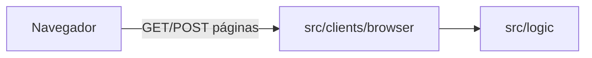

# Plan · Cliente de navegador SSR (sin API)

> Estado: **Borrador** (2026-11-03) · Spec: [spec.md](spec.md) v1.0 · Issue: #779

## 1. Visión

Añadir solo ficheros bajo `src/clients/browser/` y `docs/specs/browser-user-client/`. Un servidor `node:http` en `127.0.0.1:3000` importa funciones de `src/logic/` y responde **HTML** (enlaces y formularios `application/x-www-form-urlencoded`). Sin `/api/*`, sin `fetch`, sin cambios en logic ni en guías globales.

## 2. Ficheros

| Acción | Fichero |
| --- | --- |
| Crear | `docs/specs/browser-user-client/spec.md`, `plan.md`, `tasks.md` |
| Crear | `src/clients/browser/README.md` |
| Crear | `src/clients/browser/start-browser-server.js` |
| Crear | `src/clients/browser/handle-request.js` |
| Crear | `src/clients/browser/parse-form-body.js` |
| Crear | `src/clients/browser/render-layout.js` |
| Crear | `src/clients/browser/render-selection-page.js` |
| Crear | `src/clients/browser/render-menu-page.js` |
| Crear | `src/clients/browser/render-edit-page.js` |
| Crear | `src/clients/browser/render-error-page.js` |
| Crear | `src/clients/browser/serve-static.js` |
| Crear | `src/clients/browser/parse-user-id.js` |
| Crear | `src/clients/browser/styles.css` |

No se modifica ningún fichero fuera de esas rutas (CA-10).

## 3. Rutas y logic

El proceso Node debe ejecutarse con cwd en la raíz de `first-app` (documentado en README) para que `src/db/connection.js` resuelva `users.sqlite`.

| Método | Ruta | Logic / acción |
| --- | --- | --- |
| GET | `/` | `listUsers()` → pantalla selección |
| POST | `/select` | campo `userId` → `findUserById` → redirect GET `/menu?id=` |
| GET | `/menu` | query `id` → `findUserById` → pantalla menú |
| GET | `/edit` | query `id` → `findUserById` → formulario edición |
| POST | `/save` | `userId`, `name`, `email` → `updateUser(id, [name, email])` → redirect menú o re-render edit con error |
| POST | `/delete` | `userId` → tras confirm en cliente → `deleteUser(id)` → redirect `/` |
| GET | `/styles.css` | Fichero estático (lista cerrada) |

Validación de id en el cliente browser (antes de logic): cadena solo dígitos, entero ≥ 1; si no, página de error con mensaje claro o reutilizar `User does not exist` según el caso.

Textos visibles en español; mensajes de error de logic en inglés, sin traducir.

## 4. Comprobación de la constitución

- Clients solo llaman a `src/logic/`; no importan SQL ni abren la base directamente (CA-10).
- `updateUser(id, changes)` con array en posiciones 0 y 1 (nombre, email).
- Sin paquetes npm nuevos.

## 5. Comprobación de criterios

| CA | Cómo |
| --- | --- |
| CA-01, CA-02 | Abrir `/` con y sin usuarios en sqlite |
| CA-03, CA-04 | Seleccionar usuario; volver a `/` |
| CA-05–CA-07 | Editar, guardar, volver sin guardar |
| CA-08 | Guardar nombre vacío o email inválido |
| CA-09 | Borrar cancelar / confirmar |
| CA-10 | `git diff` sin tocar rutas prohibidas; smoke terminal + `pnpm jupyter` |
| HU-02 | Botón notas `disabled` en HTML del menú |

## 6. Arranque del frontend

Quien prueba el cliente sigue [`src/clients/browser/README.md`](../../../src/clients/browser/README.md):

| Paso | Acción |
| --- | --- |
| 1 | `cd staff/jose-miguel/first-app` (raíz del proyecto Node) |
| 2 | `node src/clients/browser/start-browser-server.js` |
| 3 | Navegador → `http://127.0.0.1:3000` |
| 4 | Ctrl+C para detener el servidor |

El entrypoint fija el cwd en first-app; no hace falta `pnpm install` extra si ya usas terminal o Jupyter en la misma carpeta.

## 7. Validación Socket

No aplica: no hay cambios en `package.json` ni dependencias.

Cierre: `node --check src/clients/browser/start-browser-server.js` y `pnpm lint` desde `first-app` (el lint recorre el repo; el código nuevo debe cumplir reglas sin editar ficheros viejos).
