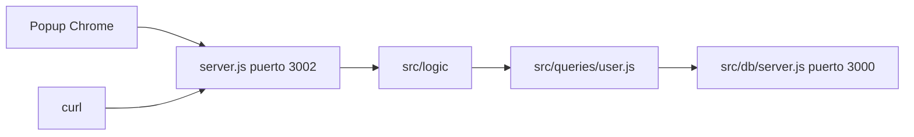

# Plan — cliente de Chrome para usuarios

Issue: #973.

No es una funcionalidad nueva de negocio. No hay fichero nuevo en `src/logic/`, ni firma nueva ni SQL nuevo ni mensaje nuevo. Es un cliente más: Fastify llama a las funciones que ya existen, como el cliente HTTP con Express. El popup no importa `src/logic/`: pide JSON a Fastify. No hay capa entre `src/logic/` y `src/queries/`.

El código actual, la constitución y la spec coinciden si se actualiza la excepción de `docs/STYLE.md` (ver «Ficheros»).

Hay un paquete nuevo: `fastify@5.12.8`, versión exacta (última publicada, `pnpm view fastify version`). Entra Socket. Aún no está instalado.

El cliente nuevo es `src/clients/chrome/`. Copia de partida de las pantallas: `index.html` y `styles.css` salen de `src/clients/web/`. `popup.js` copia las tres pantallas y el popover; las llamadas dejan de importar `src/logic/` y pasan a `fetch` contra `http://127.0.0.1:3002`. El de navegador, el de escritorio y Express no se tocan.

`server.js` se parece a `src/clients/http/server.js`: mismas cinco rutas, mismo JSON `{ "error": "<mensaje>" }`, mismos estados. Cambia Express por Fastify y el puerto 3001 por 3002.

El parser JSON viene con Fastify. Crear y modificar leen `name` y `email` del cuerpo, como Express. El `id` de la URL se comprueba con `parseUserId` (la misma regla del cliente web) antes de llamar a logic.

Manifest V3. La acción abre `index.html` en el popup. El permiso de host es `http://127.0.0.1:3002/*`. No hay content script. No hace falta CORS.

## Ficheros

Se crean:

- `src/clients/chrome/server.js`
- `src/clients/chrome/manifest.json`
- `src/clients/chrome/index.html` (copia de `src/clients/web/index.html`; el script apunta a `popup.js`)
- `src/clients/chrome/styles.css` (copia de `src/clients/web/styles.css`)
- `src/clients/chrome/popup.js` (pantallas de `src/clients/web/app.js`; datos por `fetch`)

Se tocan en la implementación (`tasks.md`):

- `package.json` (`fastify@5.12.8` y script `chrome`)
- `pnpm-lock.yaml`
- `eslint.config.js` (`console` en `src/clients/chrome/server.js`; `document` y `fetch` en `src/clients/chrome/popup.js`)
- `docs/STYLE.md` (la excepción de varias funciones cubre también `src/clients/chrome/popup.js`)
- `docs/ERRORS.md` (nota: `Body is invalid` e `Internal error` también los usa este cliente)
- `docs/TREE.md` y `docs/ARCHITECTURE.md`

No se tocan `src/logic/`, `src/queries/`, `src/db/` ni los otros clientes. No se crea cliente `.txt` en `src/clients/terminal/`.

En el árbol, `clients/` incluye `chrome/` con esos cinco ficheros. En la arquitectura, Fastify llama a `src/logic/` en `127.0.0.1:3002` y no sustituye a Express (3001) ni a la base (3000). El popup solo habla con Fastify. El script `chrome` arranca la base si el puerto 3000 está libre, como `http`.

## Llamadas

No hay función nueva. Firmas reales de `src/logic/`:

| Ruta / pantalla                    | Llamada                           | Éxito |
| ---------------------------------- | --------------------------------- | ----- |
| `GET /users` (lista del popup)     | `listUsers()`                     | 200   |
| `GET /users/:id` (elegir un id)    | `findUserById(id)`                | 200   |
| `POST /users` (solo curl)          | `createUser({ name, email })`     | 201   |
| `PATCH /users/:id` (guardar)       | `updateUser({ id, name, email })` | 200   |
| `DELETE /users/:id` (borrar)       | `deleteUser(id)`                  | 200   |

La lista del popup muestra `id`, `name` y `email`. El popup no llama a `POST /users`. No se importa `user-gender-count.js`, `find-user-by-name.js` ni `find-user-by-email.js`.

`server.js` escucha en `127.0.0.1:3002`. Al arrancar escribe esa dirección con `console.log`. El host, el origen y el puerto son las constantes `HOST`, `ORIGIN` y `PORT`.

## Firma

No hay función nueva.

## SQL

No hay SQL.

## Errores

Un `setErrorHandler` de Fastify asigna el estado por la clase del error y responde `{ error: message }`, como el middleware de Express:

| Clase             | Estado |
| ----------------- | ------ |
| `ValidationError` | 400    |
| `NotFoundError`   | 404    |
| `ConflictError`   | 409    |
| `DatabaseError`   | 500    |

| Fallo de la spec                          | Mensaje                 |
| ----------------------------------------- | ----------------------- |
| El nombre queda vacío                     | `Name is empty`         |
| El email no vale                          | `Email is invalid`      |
| El email es el de otro usuario            | `Email is already used` |
| El id no es un entero mayor o igual que 1 | `Id is invalid`         |
| Ese usuario ya no está                    | `User not found`        |
| El JSON está mal formado, o falta el cuerpo | `Body is invalid`     |
| Cualquier otro error del servidor         | `Internal error`        |

La lista vacía no es un fallo. El popup muestra el `error` del JSON, sin traducirlo. `Body is invalid` e `Internal error` ya están en `docs/ERRORS.md` por el cliente HTTP; este cliente los reutiliza. El JSON mal formado de Fastify se traduce a `Body is invalid`, 400.

## Arranque

`package.json` añade el script `chrome`. Se lanza con `pnpm chrome` desde first-app. El comando es el de `http`: si `nc -z` no encuentra nada en `127.0.0.1:3000`, arranca `src/db/server.js` en segundo plano y lo para al salir; si ya está (`pnpm server`), lo reutiliza. Después lanza `node src/clients/chrome/server.js`. `server.js` no sabe nada de esto.

La extensión se carga en Chrome sin empaquetar, carpeta `src/clients/chrome/`.

Los scripts `server`, `web`, `http`, `electron`, `jupyter`, `test`, `format` y `lint` siguen. `format` ya cubre `src/clients/**/*.js`.

## Paquete

`fastify@5.12.8`. Se instalará con `pnpm add fastify@5.12.8 --save-exact` en la implementación, no antes. Árbol hasta 3 capas según el lock que resuelve pnpm 11.1.2 para esa versión y sus rangos: 48 paquetes, sin repetir `name@version` (sí las dos versiones de `fast-uri`). Si `pnpm` resuelve otra versión dentro de un rango, esa versión no es la de este resumen y hay que volver a pasarla por Socket.

## Validación Socket

Consulta completa: el MCP respondió. `org_slug`: `sergio-cortes` (plan free).

- **Campañas:** `threat_feed` para `fastify@5.12.8` respondió 403 `threat_feed_not_entitled`. Columna `n/d (plan free)`.
- **Alertas:** la lista abierta de la org (`npm`, `open`) es completa: 275 avisos. De este árbol solo sale `fast-uri@3.1.0`, no `3.1.9` ni `4.2.3`. `alerts` filtrado por nombre quedó vacío en `fastify`, `ajv`, `cookie`, `pino`, `semver`, `ajv-formats` y `abstract-logging`. `fast-uri` filtrado: 12 avisos de `3.1.0` (detalle en la conversación). Ninguna alerta abierta nombra las versiones de este árbol.
- **Puntuaciones bajo 50:** ninguna. Lo más bajo es `maintenance 75` (`abstract-logging@2.0.1`, `fast-deep-equal@3.1.3`, `atomic-sleep@1.0.0`, `require-from-string@2.0.2`, `fast-decode-uri-component@1.0.1`, `quick-format-unescaped@4.0.4`, `json-schema-traverse@1.0.0`) y `quality 75` (`real-require@1.0.0`).
- **Incidencias:** ninguna alerta abierta para estas versiones, ninguna puntuación por debajo de 50. No hay alertas que aceptar. La persona sigue decidiendo si lo acepta.

| Capa | Paquete@versión                                 | Campaña         | Alertas | license | maintenance | quality | supplyChain | vulnerability | Stats < 50 |
| ---- | ----------------------------------------------- | --------------- | ------- | ------- | ----------- | ------- | ----------- | ------------- | ---------- |
| 0    | `fastify@5.12.8`                                | n/d (plan free) | no      | 100     | 97          | 100     | 98          | 100           | ninguna    |
| 1    | `@fastify/ajv-compiler@4.0.7`                   | n/d (plan free) | no      | 100     | 92          | 100     | 99          | 100           | ninguna    |
| 1    | `@fastify/error@4.2.1`                          | n/d (plan free) | no      | 100     | 86          | 100     | 100         | 100           | ninguna    |
| 1    | `@fastify/fast-json-stringify-compiler@5.1.1`   | n/d (plan free) | no      | 100     | 85          | 100     | 99          | 100           | ninguna    |
| 1    | `@fastify/proxy-addr@5.1.2`                     | n/d (plan free) | no      | 100     | 88          | 100     | 100         | 100           | ninguna    |
| 1    | `abstract-logging@2.0.1`                        | n/d (plan free) | no      | 100     | 75          | 77      | 100         | 100           | ninguna    |
| 1    | `avvio@9.3.1`                                   | n/d (plan free) | no      | 100     | 91          | 100     | 100         | 100           | ninguna    |
| 1    | `fast-json-stringify@7.2.1`                     | n/d (plan free) | no      | 100     | 96          | 100     | 99          | 100           | ninguna    |
| 1    | `find-my-way@9.10.0`                            | n/d (plan free) | no      | 100     | 89          | 100     | 99          | 100           | ninguna    |
| 1    | `light-my-request@6.8.0`                        | n/d (plan free) | no      | 100     | 89          | 100     | 99          | 100           | ninguna    |
| 1    | `pino@10.4.0`                                   | n/d (plan free) | no      | 100     | 90          | 100     | 98          | 100           | ninguna    |
| 1    | `process-warning@5.1.1`                         | n/d (plan free) | no      | 100     | 89          | 100     | 100         | 100           | ninguna    |
| 1    | `rfdc@1.4.1`                                    | n/d (plan free) | no      | 100     | 81          | 100     | 100         | 100           | ninguna    |
| 1    | `secure-json-parse@4.1.1`                       | n/d (plan free) | no      | 100     | 89          | 100     | 100         | 100           | ninguna    |
| 1    | `semver@7.8.6`                                  | n/d (plan free) | no      | 100     | 95          | 100     | 100         | 100           | ninguna    |
| 1    | `toad-cache@3.7.4`                              | n/d (plan free) | no      | 100     | 81          | 100     | 100         | 100           | ninguna    |
| 2    | `ajv@8.20.0`                                    | n/d (plan free) | no      | 100     | 84          | 100     | 99          | 100           | ninguna    |
| 2    | `ajv-formats@3.0.1`                             | n/d (plan free) | no      | 100     | 83          | 100     | 99          | 100           | ninguna    |
| 2    | `fast-uri@4.2.3`                                | n/d (plan free) | no      | 100     | 98          | 100     | 100         | 100           | ninguna    |
| 2    | `@fastify/forwarded@3.1.2`                      | n/d (plan free) | no      | 100     | 87          | 82      | 100         | 100           | ninguna    |
| 2    | `ipaddr.js@2.5.0`                               | n/d (plan free) | no      | 100     | 82          | 100     | 100         | 100           | ninguna    |
| 2    | `fastq@1.20.3`                                  | n/d (plan free) | no      | 100     | 82          | 100     | 100         | 100           | ninguna    |
| 2    | `@fastify/merge-json-schemas@0.2.2`             | n/d (plan free) | no      | 100     | 86          | 100     | 100         | 100           | ninguna    |
| 2    | `json-schema-ref-resolver@3.0.1`                | n/d (plan free) | no      | 100     | 88          | 100     | 100         | 100           | ninguna    |
| 2    | `fast-deep-equal@3.1.3`                         | n/d (plan free) | no      | 100     | 75          | 99      | 100         | 100           | ninguna    |
| 2    | `fast-querystring@1.1.2`                        | n/d (plan free) | no      | 100     | 79          | 100     | 99          | 100           | ninguna    |
| 2    | `safe-regex2@5.1.2`                             | n/d (plan free) | no      | 100     | 87          | 90      | 100         | 100           | ninguna    |
| 2    | `@fastify/deepmerge@3.2.4`                      | n/d (plan free) | no      | 100     | 86          | 100     | 100         | 100           | ninguna    |
| 2    | `cookie@2.0.1`                                  | n/d (plan free) | no      | 100     | 85          | 100     | 100         | 100           | ninguna    |
| 2    | `set-cookie-parser@3.2.2`                       | n/d (plan free) | no      | 100     | 93          | 100     | 100         | 100           | ninguna    |
| 2    | `@pinojs/redact@0.4.0`                          | n/d (plan free) | no      | 100     | 81          | 100     | 100         | 100           | ninguna    |
| 2    | `atomic-sleep@1.0.0`                            | n/d (plan free) | no      | 100     | 75          | 85      | 100         | 100           | ninguna    |
| 2    | `on-exit-leak-free@2.1.2`                       | n/d (plan free) | no      | 100     | 79          | 85      | 100         | 100           | ninguna    |
| 2    | `pino-abstract-transport@3.0.0`                 | n/d (plan free) | no      | 100     | 81          | 100     | 100         | 100           | ninguna    |
| 2    | `pino-std-serializers@7.1.0`                    | n/d (plan free) | no      | 100     | 82          | 100     | 100         | 100           | ninguna    |
| 2    | `quick-format-unescaped@4.0.4`                  | n/d (plan free) | no      | 100     | 75          | 89      | 100         | 100           | ninguna    |
| 2    | `real-require@1.0.0`                            | n/d (plan free) | no      | 100     | 83          | 75      | 99          | 100           | ninguna    |
| 2    | `safe-stable-stringify@2.5.0`                   | n/d (plan free) | no      | 100     | 84          | 100     | 100         | 100           | ninguna    |
| 2    | `sonic-boom@4.2.1`                              | n/d (plan free) | no      | 100     | 88          | 100     | 100         | 100           | ninguna    |
| 2    | `thread-stream@4.2.1`                           | n/d (plan free) | no      | 100     | 84          | 100     | 99          | 100           | ninguna    |
| 3    | `fast-uri@3.1.9`                                | n/d (plan free) | no      | 100     | 98          | 100     | 100         | 100           | ninguna    |
| 3    | `json-schema-traverse@1.0.0`                    | n/d (plan free) | no      | 100     | 75          | 99      | 100         | 100           | ninguna    |
| 3    | `require-from-string@2.0.2`                     | n/d (plan free) | no      | 100     | 75          | 80      | 100         | 100           | ninguna    |
| 3    | `reusify@1.1.0`                                 | n/d (plan free) | no      | 100     | 79          | 100     | 100         | 100           | ninguna    |
| 3    | `dequal@2.0.3`                                  | n/d (plan free) | no      | 100     | 79          | 100     | 100         | 100           | ninguna    |
| 3    | `fast-decode-uri-component@1.0.1`               | n/d (plan free) | no      | 100     | 75          | 81      | 100         | 100           | ninguna    |
| 3    | `ret@0.5.1`                                     | n/d (plan free) | no      | 100     | 90          | 99      | 100         | 100           | ninguna    |
| 3    | `split2@4.2.0`                                  | n/d (plan free) | no      | 100     | 80          | 95      | 100         | 100           | ninguna    |

## Decisiones

1. Popup de la acción, no pestaña. Las tres pantallas y el flujo son los del cliente de navegador.
2. Fastify replica las cinco rutas de Express; el popup no crea usuarios.
3. Puerto 3002. Permiso de host a esa API. Sin CORS extra.
4. Sin cliente `.txt` de terminal. La comprobación es `pnpm chrome`, el popup y curl de las cinco rutas.
5. `docs/STYLE.md` amplía la excepción de varias funciones a `src/clients/chrome/popup.js`.
6. Sin Chrome Web Store.

No hay `tasks.md` hasta que una persona revise este plan y la spec, y acepte el paquete.
