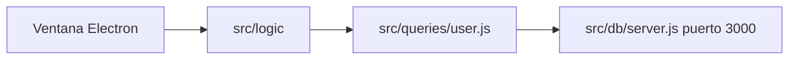

# Plan — cliente de escritorio

Issue: #924.

No es una funcionalidad nueva de negocio. No hay fichero nuevo en `src/logic/`, ni firma nueva ni SQL nuevo ni mensaje nuevo. Es un cliente más: llama a las funciones que ya existen, como la terminal, Jupyter, el cliente web y el HTTP. No hay capa entre `src/logic/` y `src/queries/`.

El código actual, la constitución y la spec coinciden si se actualiza la excepción de `docs/STYLE.md` (ver «Ficheros»).

Hay un paquete nuevo: `electron@45.2.2`, en `devDependencies`, versión exacta (última publicada, `pnpm view electron version`). Entra Socket. Aún no está instalado.

El cliente nuevo es `src/clients/electron/`. Copia de partida: `index.html`, `styles.css` y `app.js` salen de `src/clients/web/`. El de navegador no se toca. Este cliente no abre los ficheros de `web/`; carga los de su carpeta. Las rutas relativas `../../logic/` siguen valiendo.

Se parece a `src/clients/web/app.js`: las mismas llamadas y las mismas pantallas. El proceso principal se parece al tutorial de la primera ventana de Electron: importa `app` y `BrowserWindow`, carga el HTML que está junto a `main.js`, al cerrar todas las ventanas sale si la plataforma no es `darwin`, y en `darwin` vuelve a abrir una al activar si no hay ninguna.

`package.json` ya tiene `"type": "module"`. Electron admite módulos ES desde la versión 28. El campo `main` de `package.json` no se usa para este cliente: el script apunta a `src/clients/electron/main.js`.

Las pantallas copiadas usan `fetch` vía `src/queries/user.js` contra `http://127.0.0.1:3000`. No importan `node:` ni paquetes de `node_modules`. No importan `user-gender-count.js`.

No se generan instaladores. No se crea `.npmrc` y no se cambia el linker de pnpm.

## Ficheros

Se crean:

- `src/clients/electron/main.js`
- `src/clients/electron/index.html` (copia de `src/clients/web/index.html`)
- `src/clients/electron/styles.css` (copia de `src/clients/web/styles.css`)
- `src/clients/electron/app.js` (copia de `src/clients/web/app.js`)

Se tocan en la implementación (`tasks.md`):

- `package.json` (`electron@45.2.2` en `devDependencies` y script `electron`)
- `pnpm-lock.yaml`
- `eslint.config.js` (globales de `src/clients/electron/`: `process` en `main.js`; `document` y `fetch` en `app.js`)
- `docs/STYLE.md` (la excepción de varias funciones en un fichero cubre también `src/clients/electron/app.js`)
- `docs/TREE.md` y `docs/ARCHITECTURE.md`

No se tocan `src/logic/`, `src/queries/`, `src/db/` ni los otros clientes. No se crea cliente `.txt` en `src/clients/terminal/`.

En el árbol, `clients/` incluye `electron/` con `main.js`, `index.html`, `styles.css` y `app.js`. En la arquitectura, ese cliente llama a `src/logic/` con `await`, abre su ventana y no modifica `src/clients/web/`. El script `electron` arranca la base si el puerto 3000 está libre, como `http`.

## Llamadas

No hay función nueva. Firmas reales de `src/logic/`:

| Pantalla               | Llamada                           |
| ---------------------- | --------------------------------- |
| La lista               | `listUsers()`                     |
| Elegir un id           | `findUserById(id)`                |
| Guardar nombre y email | `updateUser({ id, name, email })` |
| Borrar                 | `deleteUser(id)`                  |

La lista muestra `id`, `name` y `email`. El id elegido se comprueba con la misma regla que ya tiene el cliente web (`parseUserId` en la copia de `app.js`).

## Firma

No hay función nueva.

## SQL

No hay SQL.

## Errores

| Fallo de la spec                          | Mensaje                 |
| ----------------------------------------- | ----------------------- |
| El nombre queda vacío                     | `Name is empty`         |
| El email no vale                          | `Email is invalid`      |
| El email es el de otro usuario            | `Email is already used` |
| El id no es un entero mayor o igual que 1 | `Id is invalid`         |
| Ese usuario ya no está                    | `User not found`        |

La lista vacía no es un fallo. El cliente muestra el mensaje que ya lanza `src/logic/`, sin traducirlo.

## Arranque

`package.json` añade el script `electron`. Se lanza con `pnpm electron` desde `first-app`. El comando es el de `http`: si `nc -z` no encuentra nada en `127.0.0.1:3000`, arranca `src/db/server.js` en segundo plano y lo para al salir; si ya está (`pnpm server`), lo reutiliza. Después lanza `electron src/clients/electron/main.js`. `main.js` no sabe nada de esto.

Los scripts `server`, `web`, `http`, `jupyter`, `test`, `format` y `lint` siguen. `format` ya cubre `src/clients/**/*.js`.

## Paquete

`electron@45.2.2`. Se instalará con `pnpm add -D electron@45.2.2 --save-exact` en la implementación, no antes. Árbol hasta 3 capas desde el manifest publicado (`pnpm view`): 12 paquetes, sin repetir versión. Si `pnpm` resuelve otra versión dentro de un rango, esa versión no es la de este resumen y hay que volver a pasarla por Socket.

## Validación Socket

Consulta completa: el MCP respondió. `org_slug`: `sergio-cortes` (plan free).

- **Campañas:** `threat_feed` respondió 403 `threat_feed_not_entitled` en los 12 paquetes. Columna `n/d (plan free)`.
- **Alertas:** `alerts` (org, `npm`, `open`, por nombre) devolvió lista vacía en los 12. Ninguna alerta abierta de estas versiones.
- **Puntuaciones bajo 50:** ninguna. Lo más bajo es `quality 74` (`undici-types@7.24.6`) y `maintenance 75` (`progress@2.0.3`, `sumchecker@3.0.1`).
- **Incidencias:** ninguna alerta abierta para estas versiones, ninguna puntuación por debajo de 50. No hay alertas que aceptar. La persona sigue decidiendo si lo acepta.

| Capa | Paquete@versión                        | Campaña         | Alertas | license | maintenance | quality | supplyChain | vulnerability | Stats < 50 |
| ---- | -------------------------------------- | --------------- | ------- | ------- | ----------- | ------- | ----------- | ------------- | ---------- |
| 0    | `electron@45.2.2`                      | n/d (plan free) | no      | 100     | 97          | 99      | 99          | 100           | ninguna    |
| 1    | `@electron-internal/extract-zip@1.0.8` | n/d (plan free) | no      | 100     | 94          | 98      | 95          | 100           | ninguna    |
| 1    | `@electron/get@5.1.0`                  | n/d (plan free) | no      | 100     | 82          | 100     | 99          | 100           | ninguna    |
| 1    | `@types/node@24.19.2`                  | n/d (plan free) | no      | 100     | 96          | 80      | 100         | 100           | ninguna    |
| 2    | `debug@4.4.3`                          | n/d (plan free) | no      | 100     | 81          | 100     | 99          | 100           | ninguna    |
| 2    | `env-paths@3.0.0`                      | n/d (plan free) | no      | 100     | 80          | 99      | 100         | 100           | ninguna    |
| 2    | `graceful-fs@4.2.11`                   | n/d (plan free) | no      | 100     | 79          | 100     | 99          | 100           | ninguna    |
| 2    | `progress@2.0.3`                       | n/d (plan free) | no      | 100     | 75          | 99      | 100         | 100           | ninguna    |
| 2    | `semver@7.8.6`                         | n/d (plan free) | no      | 100     | 95          | 100     | 100         | 100           | ninguna    |
| 2    | `sumchecker@3.0.1`                     | n/d (plan free) | no      | 100     | 75          | 98      | 99          | 100           | ninguna    |
| 2    | `undici-types@7.24.6`                  | n/d (plan free) | no      | 100     | 96          | 74      | 100         | 100           | ninguna    |
| 3    | `ms@2.1.3`                             | n/d (plan free) | no      | 100     | 84          | 86      | 100         | 100           | ninguna    |

## Decisiones

1. Sin cliente `.txt` de terminal. La comprobación es `pnpm electron` y las tres pantallas.
2. `electron` va en `devDependencies`.
3. Copia de las tres plantillas a `src/clients/electron/`; no se hace `loadFile` de `src/clients/web/`.
4. Sin instaladores.
5. `docs/STYLE.md` amplía la excepción de varias funciones a `src/clients/electron/app.js`.

No hay `tasks.md` hasta que una persona revise este plan y la spec, y acepte el paquete.
