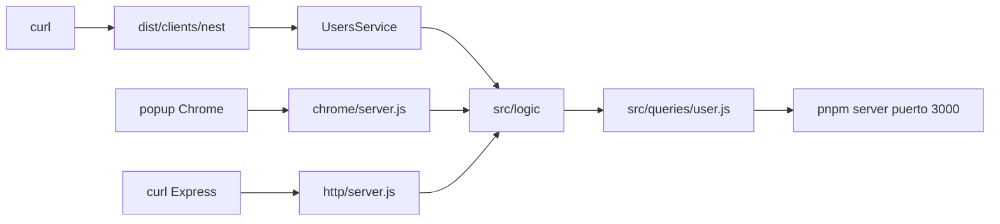

# Plan — cliente HTTP con Nest.js para usuarios

Issue: #1036.

No es una funcionalidad nueva de negocio. No hay fichero nuevo en `src/logic/`,
ni firma nueva ni SQL nuevo. Es un cliente más, con forma Nest: módulo,
controlador, servicio y filtro. `UsersService` es el único que importa
`src/logic/`. El controlador no importa logic. Nest no habla con Express ni
con Fastify.

El código actual, la constitución y la spec coinciden si se actualizan
`docs/STYLE.md` y `docs/ERRORS.md` (ver «Ficheros»). Nest usa clases, `this`,
métodos, decoradores y nombres con punto; STYLE.md lo prohíbe salvo
`src/logic/errors.js`. La persona aceptó la excepción, el contrato HTTP
(DELETE 204, `{ message }`), alinear Express y Chrome, Babel en la raíz con
`dist/`, y Socket tal como está (ver «Decisiones»). Hay paquetes nuevos. Aún
no están instalados.

## Ficheros

Se crea:

- `babel.config.json` en la raíz de first-app: `@babel/preset-env`
  (`targets.node` `current`, `modules` `false`) y
  `@babel/plugin-proposal-decorators` `{ "version": "legacy" }`.
- `src/clients/nest/main.js`: `reflect-metadata`, `NestFactory`, escucha en
  `127.0.0.1:3003`, `console.log` de la dirección.
- `src/clients/nest/app.module.js`: módulo con controlador, servicio y filtro.
- `src/clients/nest/users.controller.js`: las 5 rutas; delega en el servicio.
- `src/clients/nest/users.service.js`: importa y llama a logic.
- `src/clients/nest/http-exception.filter.js`: traduce la clase del error a
  estado y `{ message }`.

Nombres con punto, como Nest. `dist/` no se commitea. No hay `bootstrap.js`.

Se tocan en la implementación (`tasks.md`):

- `package.json` (dependencias Nest y Babel, script `nest`).
- `pnpm-lock.yaml`.
- `eslint.config.js` (`@babel/eslint-parser` con `configFile`
  `babel.config.json`, `console` en `src/clients/nest/**/*.js`).
- `.gitignore` del repo (`dist/`).
- `docs/STYLE.md` (excepción Nest: clases, `this`, métodos, decoradores;
  nombres de fichero que exige la convención de la tecnología, solo cuando
  hace falta).
- `docs/ERRORS.md` (HTTP usa `{ message }`; se quita `Internal error` de
  Express y Chrome; `Body is invalid` se conserva; nota del filtro Nest).
- `docs/TREE.md` y `docs/ARCHITECTURE.md`.
- `src/clients/http/server.js` (DELETE 204, `{ message }`, 404 vacío, fallback
  `Could not …`).
- `src/clients/chrome/server.js` (igual).
- `src/clients/chrome/popup.js` (`body.message`; DELETE 204 no lee JSON de
  éxito).

No se tocan `src/logic/`, `src/queries/`, `src/db/`, web, electron, vscode ni
jupyter. No se crea cliente `.txt` en `src/clients/terminal/`.

## Llamadas

No hay función nueva. Firmas reales de `src/logic/`. El servicio las llama:

| Ruta                | Llamada                           | Éxito     |
| ------------------- | --------------------------------- | --------- |
| `GET /users`        | `listUsers()`                     | 200       |
| `GET /users/:id`    | `findUserById(id)`                | 200       |
| `POST /users`       | `createUser({ name, email })`     | 201       |
| `PATCH /users/:id`  | `updateUser({ id, name, email })` | 200       |
| `DELETE /users/:id` | `deleteUser(id)`                  | 204 vacío |

`main.js` escucha en `127.0.0.1:3003`. Al arrancar escribe
`HTTP server listening on http://127.0.0.1:3003`. Constantes `HOST`, `ORIGIN`
y `PORT`.

El cuerpo lo lee el parser JSON del adaptador `@nestjs/platform-express`.
Crear y modificar leen `name` y `email`. `updateUser` de este repo exige los
dos; no hay PATCH parcial. Las rutas dejan salir el error; el filtro lo
traduce.

Inyección: `@Dependencies(UsersService)` en el controlador (JavaScript, sin
`emitDecoratorMetadata`).

## Id de la URL

`:id` llega como texto. El servicio lo convierte a número con la misma regla
de `parseUserId` de `src/clients/web/app.js` (solo dígitos, sin ceros a la
izquierda, entero seguro) y lanza `ValidationError("Id is invalid")`. `1abc`,
`1.5` y `0` no eligen a nadie. `checkBody` vive en el controlador.

## Errores

El filtro (`@Catch()`) asigna el estado por la **clase** de
`src/logic/errors.js` y responde `{ message }`:

| Clase             | Estado |
| ----------------- | ------ |
| `ValidationError` | 400    |
| `NotFoundError`   | 404    |
| `ConflictError`   | 409    |
| `DatabaseError`   | 500    |

`ConflictError` es solo `Email is already used` (409). `Email is invalid` es
`ValidationError` (400).

- `"Body is invalid"`, `ValidationError`, 400. JSON mal formado
  (`entity.parse.failed` o `BadRequestException` de Nest), `POST`/`PATCH` sin
  cuerpo, o cuerpo que no es un objeto. Sigue en Express y Chrome.
- Error que no es de las cuatro clases: 500 con el `Could not …` de esa
  acción (`Could not list the users`, `Could not find the user`,
  `Could not create the user`, `Could not update the user`,
  `Could not delete the user`). No se usa `Internal error`.
- Ruta que no existe: 404 sin cuerpo.

Express y Chrome copian este contrato (`{ message }`, DELETE 204, 404 vacío,
mismo fallback). El popup lee `body.message`.

## Arranque

`package.json` añade el script `nest`: si nada escucha en `127.0.0.1:3000`
(`nc -z`), arranca `src/db/server.js` en segundo plano y lo para al salir;
después `rm -rf dist && babel src -d dist --config-file ./babel.config.json && node dist/clients/nest/main.js`.
Si ya está en marcha (`pnpm server`), lo reutiliza. Compilar todo `src` hace
que `../../logic/` desde `dist/clients/nest` resuelva a `dist/logic`. `pnpm
web` / `pnpm http` / `pnpm chrome` siguen ejecutando `src/`.

`format` ya cubre `src/clients/**/*.js`. No se tocan `format`, `lint` ni
`test`.



## Paquete

Versiones exactas. Se instalarán en la implementación, no antes:

```
pnpm add @nestjs/common@12.3.3 @nestjs/core@12.3.3 @nestjs/platform-express@12.3.3 reflect-metadata@0.2.2 rxjs@7.8.2 --save-exact
pnpm add -D @babel/cli@8.1.0 @babel/core@8.1.0 @babel/preset-env@8.0.7 @babel/plugin-proposal-decorators@8.0.2 @babel/eslint-parser@8.0.7 --save-exact
```

`express@5.3.0` ya está. `@nestjs/platform-express@12.3.3` depende de
`express@5.3.0`: no cambia, no entra en Socket. `@babel/plugin-transform-class-properties`
lo trae `preset-env`; no se declara aparte. No TypeScript. No `tsx`. No
`bootstrap.js`. `emitDecoratorMetadata` no hace falta.

## Validación Socket

Consulta: el MCP respondió. `org_slug`: `sergio-cortes` (plan free). Árbol
hasta 3 capas desde el manifest publicado (`pnpm view`): 85 paquetes, sin
repetir `name@version`. `express@5.3.0` excluido.

- **Campañas:** `threat_feed` respondió 403 `threat_feed_not_entitled`. Columna
  `n/d (plan free)`.
- **Alertas:** la lista abierta de la org (`npm`, `open`) es completa: 275
  avisos, `endCursor` nulo. Ninguno nombra las versiones de este árbol. Las 9
  de capa 0, filtradas por nombre, devolvieron lista vacía. Coincidencias de
  nombre en **otra** versión (detalle en la conversación; no son de este
  árbol):
  - `@babel/core@7.29.0` (low CVE). Aquí va `8.1.0`.
  - `baseline-browser-mapping@2.10.11` (medium CVE). Aquí va `2.11.35`.
  - `browserslist@4.28.1` (high CVE). Aquí va `4.29.5`.
  - `path-to-regexp@0.1.12` (high CVE) y `8.3.0` (high y medium CVE). Aquí va
    `8.4.2`.
- **Puntuaciones bajo 50:** ninguna de las obtenidas. Lo más bajo es
  `maintenance 50` (`object-assign@4.1.1`; el umbral es &lt; 50) y `quality 64`
  en varios `@babel/helper-*`.
- **Incompleto:** `depscore` de `append-field@1.0.0` (dependencia de `multer`,
  capa 2). Socket ignoró `1.0.0` y devolvió `2.0.0`. No se atribuyen esas
  puntuaciones a `1.0.0`. El resto de `depscore` sí está.

| Capa | Paquete@versión | Campaña | Alertas | license | maintenance | quality | supplyChain | vulnerability | Stats &lt; 50 |
| ---- | --------------- | ------- | ------- | ------- | ----------- | ------- | ----------- | ------------- | ------------- |
| 0 | `@nestjs/common@12.3.3` | n/d (plan free) | no | 100 | 96 | 100 | 99 | 100 | ninguna |
| 0 | `@nestjs/core@12.3.3` | n/d (plan free) | no | 100 | 95 | 100 | 99 | 100 | ninguna |
| 0 | `@nestjs/platform-express@12.3.3` | n/d (plan free) | no | 100 | 96 | 100 | 99 | 100 | ninguna |
| 0 | `reflect-metadata@0.2.2` | n/d (plan free) | no | 80 | 80 | 99 | 100 | 100 | ninguna |
| 0 | `rxjs@7.8.2` | n/d (plan free) | no | 100 | 88 | 100 | 99 | 100 | ninguna |
| 0 | `@babel/core@8.1.0` | n/d (plan free) | no | 100 | 97 | 78 | 98 | 100 | ninguna |
| 0 | `@babel/plugin-proposal-decorators@8.0.2` | n/d (plan free) | no | 100 | 89 | 73 | 99 | 100 | ninguna |
| 0 | `@babel/plugin-transform-class-properties@8.0.1` | n/d (plan free) | no | 100 | 88 | 64 | 100 | 100 | ninguna |
| 0 | `@babel/eslint-parser@8.0.7` | n/d (plan free) | no | 100 | 97 | 75 | 99 | 100 | ninguna |
| 1 | `uid@2.0.2` | n/d (plan free) | no | 100 | 79 | 99 | 100 | 100 | ninguna |
| 1 | `tslib@2.9.1` | n/d (plan free) | no | 100 | 91 | 100 | 92 | 100 | ninguna |
| 1 | `iterare@1.2.1` | n/d (plan free) | no | 100 | 75 | 100 | 100 | 100 | ninguna |
| 1 | `load-esm@1.0.3` | n/d (plan free) | no | 100 | 79 | 95 | 100 | 100 | ninguna |
| 1 | `file-type@22.3.0` | n/d (plan free) | no | 100 | 93 | 100 | 99 | 100 | ninguna |
| 1 | `@standard-schema/spec@1.1.0` | n/d (plan free) | no | 100 | 82 | 99 | 100 | 100 | ninguna |
| 1 | `path-to-regexp@8.4.2` | n/d (plan free) | no | 100 | 91 | 100 | 100 | 100 | ninguna |
| 1 | `fast-safe-stringify@2.1.1` | n/d (plan free) | no | 100 | 75 | 100 | 100 | 100 | ninguna |
| 1 | `cors@2.8.6` | n/d (plan free) | no | 100 | 83 | 100 | 99 | 100 | ninguna |
| 1 | `multer@2.5.0` | n/d (plan free) | no | 100 | 92 | 100 | 99 | 100 | ninguna |
| 1 | `obug@3.0.0` | n/d (plan free) | no | 100 | 90 | 100 | 100 | 100 | ninguna |
| 1 | `json5@2.2.3` | n/d (plan free) | no | 100 | 81 | 100 | 100 | 100 | ninguna |
| 1 | `verkit@0.5.0` | n/d (plan free) | no | 100 | 88 | 100 | 100 | 100 | ninguna |
| 1 | `gensync@1.0.0-beta.2` | n/d (plan free) | no | 100 | 75 | 100 | 100 | 100 | ninguna |
| 1 | `empathic@2.1.0` | n/d (plan free) | no | 100 | 83 | 93 | 100 | 100 | ninguna |
| 1 | `@babel/types@8.1.0` | n/d (plan free) | no | 100 | 97 | 80 | 100 | 100 | ninguna |
| 1 | `@babel/parser@8.1.0` | n/d (plan free) | no | 100 | 98 | 80 | 100 | 100 | ninguna |
| 1 | `@babel/helpers@8.1.0` | n/d (plan free) | no | 100 | 97 | 76 | 99 | 100 | ninguna |
| 1 | `@types/gensync@1.0.5` | n/d (plan free) | no | 100 | 80 | 70 | 100 | 100 | ninguna |
| 1 | `@babel/template@8.0.0` | n/d (plan free) | no | 100 | 88 | 75 | 100 | 100 | ninguna |
| 1 | `@babel/traverse@8.1.0` | n/d (plan free) | no | 100 | 97 | 79 | 99 | 100 | ninguna |
| 1 | `@babel/generator@8.1.0` | n/d (plan free) | no | 100 | 96 | 78 | 99 | 100 | ninguna |
| 1 | `@babel/code-frame@8.0.6` | n/d (plan free) | no | 100 | 90 | 73 | 100 | 100 | ninguna |
| 1 | `convert-source-map@2.0.0` | n/d (plan free) | no | 100 | 81 | 100 | 100 | 100 | ninguna |
| 1 | `import-meta-resolve@4.2.0` | n/d (plan free) | no | 100 | 79 | 100 | 99 | 100 | ninguna |
| 1 | `@babel/helper-compilation-targets@8.0.7` | n/d (plan free) | no | 100 | 96 | 74 | 99 | 100 | ninguna |
| 1 | `@babel/helper-create-class-features-plugin@8.0.10` | n/d (plan free) | no | 100 | 96 | 77 | 99 | 100 | ninguna |
| 1 | `@babel/helper-plugin-utils@8.0.1` | n/d (plan free) | no | 100 | 88 | 70 | 100 | 100 | ninguna |
| 1 | `@babel/plugin-syntax-decorators@8.0.1` | n/d (plan free) | no | 100 | 88 | 67 | 100 | 100 | ninguna |
| 1 | `eslint-scope@9.1.2` | n/d (plan free) | no | 100 | 84 | 100 | 100 | 100 | ninguna |
| 1 | `eslint-visitor-keys@5.0.1` | n/d (plan free) | no | 100 | 83 | 100 | 100 | 100 | ninguna |
| 2 | `@lukeed/csprng@1.1.0` | n/d (plan free) | no | 100 | 79 | 87 | 100 | 100 | ninguna |
| 2 | `strtok3@10.7.0` | n/d (plan free) | no | 100 | 93 | 100 | 100 | 100 | ninguna |
| 2 | `token-types@6.2.0` | n/d (plan free) | no | 100 | 87 | 100 | 99 | 100 | ninguna |
| 2 | `uint8array-extras@1.6.0` | n/d (plan free) | no | 100 | 82 | 100 | 100 | 100 | ninguna |
| 2 | `@tokenizer/inflate@0.6.0` | n/d (plan free) | no | 100 | 90 | 99 | 99 | 100 | ninguna |
| 2 | `object-assign@4.1.1` | n/d (plan free) | no | 100 | 50 | 85 | 67 | 100 | ninguna |
| 2 | `vary@1.1.2` | n/d (plan free) | no | 100 | 75 | 99 | 100 | 100 | ninguna |
| 2 | `busboy@1.6.0` | n/d (plan free) | no | 100 | 80 | 100 | 100 | 100 | ninguna |
| 2 | `type-is@1.6.18` | n/d (plan free) | no | 100 | 87 | 100 | 100 | 100 | ninguna |
| 2 | `append-field@1.0.0` | n/d (plan free) | no | n/d | n/d | n/d | n/d | n/d | n/d |
| 2 | `@babel/helper-string-parser@8.0.8` | n/d (plan free) | no | 100 | 94 | 74 | 100 | 100 | ninguna |
| 2 | `@babel/helper-validator-identifier@8.0.6` | n/d (plan free) | no | 100 | 90 | 72 | 100 | 100 | ninguna |
| 2 | `@babel/helper-globals@8.0.6` | n/d (plan free) | no | 100 | 89 | 75 | 100 | 100 | ninguna |
| 2 | `jsesc@3.1.0` | n/d (plan free) | no | 100 | 79 | 100 | 100 | 100 | ninguna |
| 2 | `@types/jsesc@2.5.1` | n/d (plan free) | no | 100 | 79 | 69 | 100 | 100 | ninguna |
| 2 | `@jridgewell/gen-mapping@0.4.0-beta.0` | n/d (plan free) | no | 100 | 80 | 100 | 100 | 100 | ninguna |
| 2 | `@jridgewell/trace-mapping@0.3.31` | n/d (plan free) | no | 100 | 80 | 100 | 100 | 100 | ninguna |
| 2 | `js-tokens@10.0.0` | n/d (plan free) | no | 100 | 80 | 72 | 100 | 100 | ninguna |
| 2 | `flru@1.0.2` | n/d (plan free) | no | 100 | 75 | 99 | 100 | 100 | ninguna |
| 2 | `browserslist@4.29.5` | n/d (plan free) | no | 100 | 92 | 90 | 98 | 100 | ninguna |
| 2 | `@babel/compat-data@8.0.5` | n/d (plan free) | no | 100 | 90 | 75 | 100 | 100 | ninguna |
| 2 | `@babel/helper-validator-option@8.0.0` | n/d (plan free) | no | 100 | 88 | 71 | 100 | 100 | ninguna |
| 2 | `@babel/helper-replace-supers@8.0.1` | n/d (plan free) | no | 100 | 88 | 73 | 100 | 100 | ninguna |
| 2 | `@babel/helper-annotate-as-pure@8.0.0` | n/d (plan free) | no | 100 | 88 | 64 | 100 | 100 | ninguna |
| 2 | `@babel/helper-optimise-call-expression@8.0.0` | n/d (plan free) | no | 100 | 88 | 68 | 100 | 100 | ninguna |
| 2 | `@babel/helper-member-expression-to-functions@8.0.5` | n/d (plan free) | no | 100 | 90 | 74 | 100 | 100 | ninguna |
| 2 | `@babel/helper-skip-transparent-expression-wrappers@8.1.0` | n/d (plan free) | no | 100 | 88 | 66 | 100 | 100 | ninguna |
| 2 | `@types/esrecurse@4.3.1` | n/d (plan free) | no | 100 | 79 | 89 | 100 | 100 | ninguna |
| 2 | `@types/estree@1.0.10` | n/d (plan free) | no | 100 | 87 | 74 | 100 | 100 | ninguna |
| 2 | `esrecurse@4.3.0` | n/d (plan free) | no | 100 | 75 | 100 | 99 | 100 | ninguna |
| 2 | `estraverse@5.3.0` | n/d (plan free) | no | 100 | 75 | 100 | 100 | 100 | ninguna |
| 3 | `@tokenizer/token@0.3.0` | n/d (plan free) | no | 100 | 75 | 64 | 100 | 100 | ninguna |
| 3 | `ieee754@1.2.1` | n/d (plan free) | no | 100 | 75 | 82 | 100 | 100 | ninguna |
| 3 | `@borewit/text-codec@0.2.3` | n/d (plan free) | no | 100 | 87 | 95 | 100 | 100 | ninguna |
| 3 | `debug@4.4.3` | n/d (plan free) | no | 100 | 81 | 100 | 99 | 100 | ninguna |
| 3 | `streamsearch@1.1.0` | n/d (plan free) | no | 100 | 79 | 98 | 100 | 100 | ninguna |
| 3 | `mime-types@2.1.35` | n/d (plan free) | no | 100 | 85 | 99 | 100 | 100 | ninguna |
| 3 | `media-typer@0.3.0` | n/d (plan free) | no | 100 | 84 | 93 | 100 | 100 | ninguna |
| 3 | `@jridgewell/sourcemap-codec@1.6.0` | n/d (plan free) | no | 100 | 81 | 100 | 100 | 100 | ninguna |
| 3 | `@jridgewell/resolve-uri@3.1.2` | n/d (plan free) | no | 100 | 79 | 81 | 100 | 100 | ninguna |
| 3 | `caniuse-lite@1.0.30001820` | n/d (plan free) | no | 100 | 96 | 74 | 100 | 100 | ninguna |
| 3 | `node-releases@2.0.63` | n/d (plan free) | no | 100 | 95 | 81 | 100 | 100 | ninguna |
| 3 | `electron-to-chromium@1.5.476` | n/d (plan free) | no | 100 | 96 | 100 | 100 | 100 | ninguna |
| 3 | `update-browserslist-db@1.3.4` | n/d (plan free) | no | 100 | 89 | 82 | 99 | 100 | ninguna |
| 3 | `baseline-browser-mapping@2.11.35` | n/d (plan free) | no | 100 | 96 | 99 | 99 | 100 | ninguna |

### `@babel/cli@8.1.0` y `@babel/preset-env@8.0.7`

Consulta extra para el arranque `babel src -d dist` (no estaban en el árbol
anterior). `org_slug`: `sergio-cortes` (plan free). Capa 0 nueva: esas dos.
Hasta 3 capas, sin repetir un `name@version` ya revisado arriba.

- **Campañas:** `threat_feed` para las dos de capa 0: 403
  `threat_feed_not_entitled`. Columna `n/d (plan free)`.
- **Alertas:** `alerts` filtrado por nombre, capa 0: lista vacía (`@babel/cli`,
  `@babel/preset-env`). Coincidencias de **nombre** en otra versión (no son
  de este árbol):
  - `glob@10.3.10` (high CVE `GHSA-5j98-mcp5-4vw2`, CLI `-c` / `shell:true`).
    Aquí va `14.0.3`. Parche listado: `10.5.0` / `11.1.0`.
  - `glob@7.2.3`, `10.5.0`, `11.1.0` (deprecated / maintenance). No es
    `14.0.3`.
  - `@types/minimatch@6.0.0` (deprecated). Aquí `minimatch@11.0.4`.
- **Puntuaciones bajo 50 (obtenidas):** ninguna. Lo más bajo es `quality 62`
  (`@babel/plugin-transform-dotall-regex@8.0.1`,
  `@babel/plugin-transform-regexp-modifiers@8.0.1`,
  `@babel/plugin-transform-unicode-regex@8.0.1`,
  `@babel/plugin-transform-unicode-sets-regex@8.0.1`).
- **Incompleto:** `depscore` de 16 paquetes de capas 2–3 falló con 429
  (`Requires 100, token has only 51`). No se inventan puntuaciones. Lista:
  `@babel/helper-create-regexp-features-plugin@8.0.7`,
  `@babel/helper-define-polyfill-provider@1.0.0`,
  `@babel/helper-module-imports@8.0.0`,
  `@babel/helper-module-transforms@8.1.0`,
  `@babel/helper-remap-async-to-generator@8.0.1`, `esutils@2.0.3`,
  `minimatch@11.0.4`, `minipass@7.1.3`, `path-scurry@3.0.0`,
  `readdirp@5.1.1`, `@babel/helper-wrap-function@8.0.0`,
  `@isaacs/nonrecursive-glob-match@1.0.3`, `brace-expansion@5.0.12`,
  `lodash.debounce@4.0.8`, `lru-cache@11.5.3`, `regexpu-core@6.5.4`.

| Capa | Paquete@versión | Campaña | Alertas | license | maintenance | quality | supplyChain | vulnerability | Stats &lt; 50 |
| ---- | --------------- | ------- | ------- | ------- | ----------- | ------- | ----------- | ------------- | ------------- |
| 0 | `@babel/cli@8.1.0` | n/d (plan free) | no | 100 | 95 | 75 | 99 | 100 | ninguna |
| 0 | `@babel/preset-env@8.0.7` | n/d (plan free) | no | 100 | 95 | 75 | 96 | 100 | ninguna |
| 1 | `chokidar@5.0.0` | n/d (plan free) | no | 100 | 85 | 100 | 99 | 100 | ninguna |
| 1 | `commander@14.0.3` | n/d (plan free) | no | 100 | 83 | 100 | 99 | 100 | ninguna |
| 1 | `glob@14.0.3` | n/d (plan free) | no | 100 | 92 | 99 | 98 | 100 | ninguna |
| 1 | `slash@5.1.0` | n/d (plan free) | no | 100 | 79 | 72 | 100 | 100 | ninguna |
| 1 | `core-js-compat@3.51.0` | n/d (plan free) | no | 100 | 87 | 100 | 100 | 100 | ninguna |
| 1 | `@babel/preset-modules@0.2.0` | n/d (plan free) | no | 100 | 84 | 99 | 99 | 100 | ninguna |
| 1 | `babel-plugin-polyfill-corejs3@1.0.0` | n/d (plan free) | no | 100 | 83 | 93 | 99 | 100 | ninguna |
| 1 | `@babel/plugin-bugfix-firefox-class-in-computed-class-key@8.0.1` | n/d (plan free) | no | 100 | 88 | 70 | 100 | 100 | ninguna |
| 1 | `@babel/plugin-bugfix-safari-class-field-initializer-scope@8.0.1` | n/d (plan free) | no | 100 | 88 | 70 | 100 | 100 | ninguna |
| 1 | `@babel/plugin-bugfix-safari-id-destructuring-collision-in-function-expression@8.0.1` | n/d (plan free) | no | 100 | 88 | 68 | 100 | 100 | ninguna |
| 1 | `@babel/plugin-bugfix-safari-rest-destructuring-rhs-array@8.0.6` | n/d (plan free) | no | 100 | 91 | 68 | 100 | 100 | ninguna |
| 1 | `@babel/plugin-bugfix-v8-spread-parameters-in-optional-chaining@8.0.1` | n/d (plan free) | no | 100 | 88 | 70 | 99 | 100 | ninguna |
| 1 | `@babel/plugin-bugfix-v8-static-class-fields-redefine-readonly@8.0.1` | n/d (plan free) | no | 100 | 88 | 72 | 100 | 100 | ninguna |
| 1 | `@babel/plugin-transform-arrow-functions@8.0.1` | n/d (plan free) | no | 100 | 88 | 66 | 99 | 100 | ninguna |
| 1 | `@babel/plugin-transform-async-generator-functions@8.0.6` | n/d (plan free) | no | 100 | 93 | 72 | 99 | 100 | ninguna |
| 1 | `@babel/plugin-transform-async-to-generator@8.0.1` | n/d (plan free) | no | 100 | 88 | 69 | 99 | 100 | ninguna |
| 1 | `@babel/plugin-transform-block-scoped-functions@8.0.1` | n/d (plan free) | no | 100 | 88 | 70 | 100 | 100 | ninguna |
| 1 | `@babel/plugin-transform-block-scoping@8.0.10` | n/d (plan free) | no | 100 | 96 | 75 | 99 | 100 | ninguna |
| 1 | `@babel/plugin-transform-class-static-block@8.0.5` | n/d (plan free) | no | 100 | 90 | 72 | 100 | 100 | ninguna |
| 1 | `@babel/plugin-transform-classes@8.1.0` | n/d (plan free) | no | 100 | 96 | 75 | 99 | 100 | ninguna |
| 1 | `@babel/plugin-transform-computed-properties@8.0.1` | n/d (plan free) | no | 100 | 88 | 72 | 100 | 100 | ninguna |
| 1 | `@babel/plugin-transform-destructuring@8.0.5` | n/d (plan free) | no | 100 | 90 | 75 | 100 | 100 | ninguna |
| 1 | `@babel/plugin-transform-dotall-regex@8.0.1` | n/d (plan free) | no | 100 | 88 | 62 | 99 | 100 | ninguna |
| 1 | `@babel/plugin-transform-duplicate-keys@8.0.1` | n/d (plan free) | no | 100 | 88 | 69 | 100 | 100 | ninguna |
| 1 | `@babel/plugin-transform-duplicate-named-capturing-groups-regex@8.0.1` | n/d (plan free) | no | 100 | 88 | 65 | 99 | 100 | ninguna |
| 1 | `@babel/plugin-transform-dynamic-import@8.0.1` | n/d (plan free) | no | 100 | 88 | 67 | 100 | 100 | ninguna |
| 1 | `@babel/plugin-transform-explicit-resource-management@8.0.5` | n/d (plan free) | no | 100 | 90 | 72 | 99 | 100 | ninguna |
| 1 | `@babel/plugin-transform-exponentiation-operator@8.0.1` | n/d (plan free) | no | 100 | 88 | 70 | 100 | 100 | ninguna |
| 1 | `@babel/plugin-transform-export-namespace-from@8.1.0` | n/d (plan free) | no | 100 | 88 | 69 | 100 | 100 | ninguna |
| 1 | `@babel/plugin-transform-for-of@8.0.7` | n/d (plan free) | no | 100 | 92 | 72 | 100 | 100 | ninguna |
| 1 | `@babel/plugin-transform-function-name@8.0.1` | n/d (plan free) | no | 100 | 88 | 66 | 100 | 100 | ninguna |
| 1 | `@babel/plugin-transform-json-strings@8.0.1` | n/d (plan free) | no | 100 | 88 | 66 | 100 | 100 | ninguna |
| 1 | `@babel/plugin-transform-literals@8.0.1` | n/d (plan free) | no | 100 | 88 | 66 | 100 | 100 | ninguna |
| 1 | `@babel/plugin-transform-logical-assignment-operators@8.0.1` | n/d (plan free) | no | 100 | 88 | 69 | 100 | 100 | ninguna |
| 1 | `@babel/plugin-transform-member-expression-literals@8.0.1` | n/d (plan free) | no | 100 | 88 | 65 | 100 | 100 | ninguna |
| 1 | `@babel/plugin-transform-modules-amd@8.0.1` | n/d (plan free) | no | 100 | 88 | 72 | 99 | 100 | ninguna |
| 1 | `@babel/plugin-transform-modules-commonjs@8.0.1` | n/d (plan free) | no | 100 | 88 | 73 | 100 | 100 | ninguna |
| 1 | `@babel/plugin-transform-modules-systemjs@8.1.0` | n/d (plan free) | no | 100 | 89 | 74 | 99 | 100 | ninguna |
| 1 | `@babel/plugin-transform-modules-umd@8.0.1` | n/d (plan free) | no | 100 | 88 | 72 | 99 | 100 | ninguna |
| 1 | `@babel/plugin-transform-named-capturing-groups-regex@8.0.1` | n/d (plan free) | no | 100 | 88 | 65 | 99 | 100 | ninguna |
| 1 | `@babel/plugin-transform-new-target@8.0.1` | n/d (plan free) | no | 100 | 88 | 70 | 100 | 100 | ninguna |
| 1 | `@babel/plugin-transform-nullish-coalescing-operator@8.0.1` | n/d (plan free) | no | 100 | 88 | 69 | 100 | 100 | ninguna |
| 1 | `@babel/plugin-transform-numeric-separator@8.0.1` | n/d (plan free) | no | 100 | 88 | 66 | 100 | 100 | ninguna |
| 1 | `@babel/plugin-transform-object-rest-spread@8.0.1` | n/d (plan free) | no | 100 | 88 | 75 | 99 | 100 | ninguna |
| 1 | `@babel/plugin-transform-object-super@8.0.1` | n/d (plan free) | no | 100 | 88 | 70 | 100 | 100 | ninguna |
| 1 | `@babel/plugin-transform-optional-catch-binding@8.0.1` | n/d (plan free) | no | 100 | 88 | 65 | 100 | 100 | ninguna |
| 1 | `@babel/plugin-transform-optional-chaining@8.0.5` | n/d (plan free) | no | 100 | 90 | 73 | 99 | 100 | ninguna |
| 1 | `@babel/plugin-transform-parameters@8.0.5` | n/d (plan free) | no | 100 | 90 | 75 | 99 | 100 | ninguna |
| 1 | `@babel/plugin-transform-private-methods@8.0.1` | n/d (plan free) | no | 100 | 88 | 65 | 99 | 100 | ninguna |
| 1 | `@babel/plugin-transform-private-property-in-object@8.0.5` | n/d (plan free) | no | 100 | 90 | 72 | 99 | 100 | ninguna |
| 1 | `@babel/plugin-transform-property-literals@8.0.1` | n/d (plan free) | no | 100 | 88 | 65 | 100 | 100 | ninguna |
| 1 | `@babel/plugin-transform-regenerator@8.0.6` | n/d (plan free) | no | 100 | 92 | 76 | 99 | 100 | ninguna |
| 1 | `@babel/plugin-transform-regexp-modifiers@8.0.1` | n/d (plan free) | no | 100 | 88 | 62 | 99 | 100 | ninguna |
| 1 | `@babel/plugin-transform-reserved-words@8.0.1` | n/d (plan free) | no | 100 | 88 | 64 | 100 | 100 | ninguna |
| 1 | `@babel/plugin-transform-shorthand-properties@8.0.1` | n/d (plan free) | no | 100 | 88 | 69 | 100 | 100 | ninguna |
| 1 | `@babel/plugin-transform-spread@8.0.8` | n/d (plan free) | no | 100 | 90 | 72 | 99 | 100 | ninguna |
| 1 | `@babel/plugin-transform-sticky-regex@8.0.1` | n/d (plan free) | no | 100 | 88 | 65 | 100 | 100 | ninguna |
| 1 | `@babel/plugin-transform-template-literals@8.0.1` | n/d (plan free) | no | 100 | 88 | 71 | 100 | 100 | ninguna |
| 1 | `@babel/plugin-transform-typeof-symbol@8.0.1` | n/d (plan free) | no | 100 | 88 | 69 | 100 | 100 | ninguna |
| 1 | `@babel/plugin-transform-unicode-escapes@8.0.1` | n/d (plan free) | no | 100 | 88 | 71 | 100 | 100 | ninguna |
| 1 | `@babel/plugin-transform-unicode-property-regex@8.0.1` | n/d (plan free) | no | 100 | 88 | 65 | 100 | 100 | ninguna |
| 1 | `@babel/plugin-transform-unicode-regex@8.0.1` | n/d (plan free) | no | 100 | 88 | 62 | 99 | 100 | ninguna |
| 1 | `@babel/plugin-transform-unicode-sets-regex@8.0.1` | n/d (plan free) | no | 100 | 88 | 62 | 99 | 100 | ninguna |
| 2 | `@babel/helper-create-regexp-features-plugin@8.0.7` | n/d (plan free) | no | n/d | n/d | n/d | n/d | n/d | n/d |
| 2 | `@babel/helper-define-polyfill-provider@1.0.0` | n/d (plan free) | no | n/d | n/d | n/d | n/d | n/d | n/d |
| 2 | `@babel/helper-module-imports@8.0.0` | n/d (plan free) | no | n/d | n/d | n/d | n/d | n/d | n/d |
| 2 | `@babel/helper-module-transforms@8.1.0` | n/d (plan free) | no | n/d | n/d | n/d | n/d | n/d | n/d |
| 2 | `@babel/helper-remap-async-to-generator@8.0.1` | n/d (plan free) | no | n/d | n/d | n/d | n/d | n/d | n/d |
| 2 | `esutils@2.0.3` | n/d (plan free) | no | n/d | n/d | n/d | n/d | n/d | n/d |
| 2 | `minimatch@11.0.4` | n/d (plan free) | no | n/d | n/d | n/d | n/d | n/d | n/d |
| 2 | `minipass@7.1.3` | n/d (plan free) | no | n/d | n/d | n/d | n/d | n/d | n/d |
| 2 | `path-scurry@3.0.0` | n/d (plan free) | no | n/d | n/d | n/d | n/d | n/d | n/d |
| 2 | `readdirp@5.1.1` | n/d (plan free) | no | n/d | n/d | n/d | n/d | n/d | n/d |
| 3 | `@babel/helper-wrap-function@8.0.0` | n/d (plan free) | no | n/d | n/d | n/d | n/d | n/d | n/d |
| 3 | `@isaacs/nonrecursive-glob-match@1.0.3` | n/d (plan free) | no | n/d | n/d | n/d | n/d | n/d | n/d |
| 3 | `brace-expansion@5.0.12` | n/d (plan free) | no | n/d | n/d | n/d | n/d | n/d | n/d |
| 3 | `lodash.debounce@4.0.8` | n/d (plan free) | no | n/d | n/d | n/d | n/d | n/d | n/d |
| 3 | `lru-cache@11.5.3` | n/d (plan free) | no | n/d | n/d | n/d | n/d | n/d | n/d |
| 3 | `regexpu-core@6.5.4` | n/d (plan free) | no | n/d | n/d | n/d | n/d | n/d | n/d |

## Decisiones

1. Excepción de `docs/STYLE.md` en `src/clients/nest/`: clases, `this`,
   métodos, decoradores. Nombres de fichero que exige la tecnología, solo
   cuando hace falta (Nest: `app.module.js`, …).
2. `UsersService` llama a logic. El controlador no importa logic.
3. Adaptador `@nestjs/platform-express`. Babel: `babel.config.json` en la
   raíz, `babel src -d dist`, `node dist/clients/nest/main.js`. Sin
   `bootstrap.js`.
4. DELETE 204 vacío. Fallo `{ "message": "<texto>" }`. Express y Chrome se
   alinean. El popup lee `message`.
5. Filtro por clase. `Email is already used` → 409. `Email is invalid` → 400.
   Sin `Internal error`. Fallback `Could not …` de la acción. Ruta
   desconocida: 404 vacío. `Body is invalid` se conserva.
6. PATCH con name y email. Sin cambio de logic.
7. Sin cliente `.txt`. Comprobación: `curl` en 3001, 3002 y 3003.
8. Socket: se acepta con `append-field@1.0.0` sin `depscore` y con las 16
   filas de capas 2–3 de Babel sin `depscore`. No hay alertas de estas
   versiones que aceptar.
