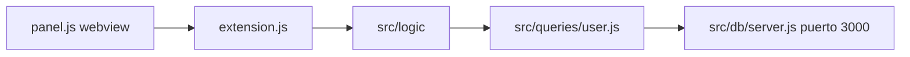

# Plan — cliente de VS Code para usuarios

Issue: #1018.

No es una funcionalidad nueva de negocio. No hay fichero nuevo en `src/logic/`, ni firma nueva ni SQL nuevo ni mensaje nuevo. Es un cliente más. El proceso de la extensión importa las funciones que ya existen, como Electron. El panel no importa `src/logic/`: habla con el proceso por mensajes. No hay capa entre `src/logic/` y `src/queries/`. No hay puerto ni API HTTP nuevos.

El código actual, la constitución y la spec coinciden si se actualiza la excepción de `docs/STYLE.md` (ver «Ficheros»).

No hay paquete de Node nuevo ni cambio de versión. Socket no entra.

El cliente nuevo es `src/clients/vscode/`. Copia de partida de las pantallas: `index.html` y `styles.css` salen de `src/clients/web/`. En la primera pantalla se añade el control de búsqueda (criterio y valor). `panel.js` copia las tres pantallas, el alta, el popover y el teclado; las llamadas dejan de importar `src/logic/` y pasan a mensajes hacia `extension.js`. El de navegador, el de escritorio, Chrome y Express no se tocan.

`extension.js` se parece a `src/clients/electron/main.js` en que vive en el proceso y no pinta la pantalla, y a `src/clients/chrome/server.js` en que traduce cada acción a una función de `src/logic/`. Abre un webview como pestaña de editor. El comando es `First App: Abrir usuarios`.

## Ficheros

Se crean:

- `src/clients/vscode/package.json` (manifiesto de la extensión; `type` `module`; sin dependencias npm)
- `src/clients/vscode/extension.js` (proceso: importa `src/logic/`, abre el panel, atiende mensajes)
- `src/clients/vscode/index.html` (copia de `src/clients/web/index.html` más el recuadro de búsqueda; el script apunta a `panel.js`)
- `src/clients/vscode/styles.css` (copia de `src/clients/web/styles.css`; ya tiene `:focus-visible`)
- `src/clients/vscode/panel.js` (pantallas de `src/clients/web/app.js` más búsqueda; datos por mensajes)
- `src/clients/vscode/.vscode/launch.json` (F5 / Run Extension con esta carpeta)
- `README.md` (cómo arrancar y reabrir este cliente; cómo usar el de Chrome)

Se tocan en la implementación (`tasks.md`):

- `eslint.config.js` (`document` y `acquireVsCodeApi` en `src/clients/vscode/panel.js`)
- `docs/STYLE.md` (la excepción de varias funciones cubre también `src/clients/vscode/panel.js` y `src/clients/vscode/extension.js`)
- `docs/TREE.md` y `docs/ARCHITECTURE.md`

No se tocan `src/logic/`, `src/queries/`, `src/db/` ni los otros clientes. En first-app solo se añade el script `vscode` y `README.md`. No se crea cliente `.txt` en `src/clients/terminal/`.

En el árbol, `first-app/` incluye `README.md`. `clients/` incluye `vscode/` con esos ficheros. En la arquitectura, el proceso de la extensión llama a `src/logic/` y el panel solo habla con ese proceso. No sustituye a Express (3001), Fastify (3002) ni a la base (3000). El README explica VS Code y Chrome.

## Llamadas

No hay función nueva. Firmas reales de `src/logic/`:

| Acción del panel                         | Llamada en `extension.js`         |
| ---------------------------------------- | --------------------------------- |
| Lista / actualizar lista                 | `listUsers()`                     |
| Alta                                     | `createUser({ name, email })`     |
| Búsqueda por nombre                      | `findUserByName(name)`            |
| Búsqueda por email                       | `findUserByEmail(email)`          |
| Búsqueda por id / elegir un id           | `findUserById(id)`                |
| Guardar                                  | `updateUser({ id, name, email })` |
| Borrar (solo si el email del popover coincide) | `deleteUser(id)`            |

El id que llega como texto se comprueba con `parseUserId` (la misma regla del cliente web) antes de llamar a logic. El email del popover se compara en `panel.js` como en `src/clients/web/app.js`; si no coincide no hay mensaje al proceso.

No se importa `user-gender-count.js`.

## Firma

No hay función nueva.

## SQL

No hay SQL.

## Errores

El panel muestra `error.message`, sin traducirlo, como el cliente de navegador.

| Fallo de la spec                          | Mensaje                     |
| ----------------------------------------- | --------------------------- |
| El nombre queda vacío                     | `Name is empty`             |
| El email no vale                          | `Email is invalid`          |
| El email es el de otro usuario            | `Email is already used`     |
| El id no es un entero mayor o igual que 1 | `Id is invalid`             |
| Ese usuario ya no está                    | `User not found`            |
| No se puede crear                         | `Could not create the user` |
| No se puede listar                        | `Could not list the users`  |
| No se puede buscar o ver uno              | `Could not find the user`   |
| No se puede guardar                       | `Could not update the user` |
| No se puede borrar                        | `Could not delete the user` |

La lista vacía y el nombre buscado sin coincidencias no son un fallo. El popover de borrado no llama a logic si el email no coincide.

## Arranque

La base no la arranca la extensión. El `package.json` de first-app incluye el script `vscode`.

VS Code:

1. Desde first-app, `pnpm server` si nada escucha en `127.0.0.1:3000`.
2. Desde first-app, `pnpm vscode`. Abre VS Code en `src/clients/vscode/` con `--extensionDevelopmentPath`.
3. Paleta de comandos → `First App: Abrir usuarios`. El panel queda como pestaña de editor.

Tras cerrar VS Code, los mismos pasos. F5 solo hace falta para depurar con breakpoints.

En el webview, `extension.js` sustituye `./styles.css` y `./panel.js` del HTML por URIs del webview. `styles.css` fija colores propios para que el tema de VS Code no atenúe los textos.

Chrome (solo documentación en `README.md`; el cliente no se toca):

1. Desde first-app, `pnpm chrome`. Si el puerto 3000 está libre, arranca la base; si ya está, la usa. Fastify queda en `http://127.0.0.1:3002`.
2. En Chrome, cargar `src/clients/chrome/` sin empaquetar.
3. El icono de la extensión abre el popup.

Los scripts `server`, `web`, `http`, `electron`, `chrome`, `vscode`, `jupyter`, `test`, `format` y `lint` siguen. `format` ya cubre `src/clients/**/*.js`.

## Paquete

Ninguno. No se añade ni se cambia un paquete de Node. El `package.json` de `src/clients/vscode/` es el manifiesto de la extensión (`engines.vscode`, comando, `main`). El módulo `vscode` lo aporta el Extension Development Host; no se instala. No hay `pnpm add`.

## Validación Socket

No aplica: no hay paquete nuevo ni cambio de versión. No hay alertas que aceptar.

## Decisiones

1. Pestaña de editor y comando `First App: Abrir usuarios`, no barra lateral. Sin API ni puerto nuevos.
2. Mismas tres pantallas crema/teal que el navegador, más búsqueda y alta en la primera. Copia de partida, no HTML compartido.
3. Criterio + valor exactos. `findUserByName` puede devolver varios. Un solo resultado abre el menú del usuario. Varios llenan el desplegable y hay que continuar. Actualizar lista restaura todos en la pantalla de selección.
4. Popover de borrado como el de navegador. Sin cliente `.txt` de terminal.
5. `docs/STYLE.md` amplía la excepción de varias funciones a `panel.js` y `extension.js`.
6. `README.md` nuevo en first-app: VS Code (arrancar y reabrir) y Chrome (cómo usarlo).
7. Sin Marketplace.

No hay `tasks.md` hasta que una persona revise este plan y la spec.
